

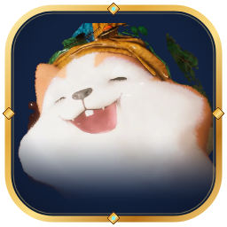

# Aion 2 Companion

**Almas de mascotas, el Mercader de la Nube Negra, timers de field bosses y un medidor de DPS en directo para Aion 2, en una sola app.**

### [⬇ Descargar la última versión](https://github.com/r3b0rNjHs/aion2-companion-releases/releases/latest)

El instalador (`Aion2Companion-Setup-….exe`) y el ZIP portable están en **Assets**, en la página de la versión ·
[Todas las versiones](https://github.com/r3b0rNjHs/aion2-companion-releases/releases) ·
[English](README.md) · **Español**

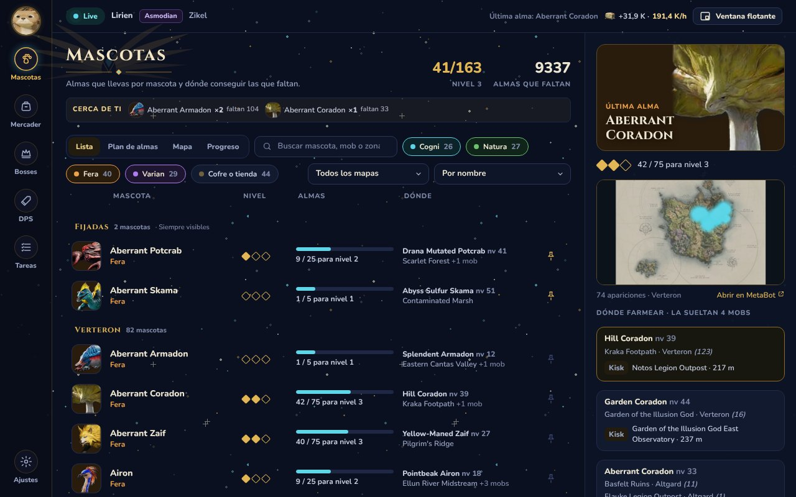

## Qué hace

| | |
| --- | --- |
| **Mascotas** | Cada mascota que no tienes al máximo, con su retrato, tus almas, el mob que la suelta, la zona, el kisk más cercano y un mapa de sus apariciones. Un aviso en cada alma te dice cuántas faltan, y «Cerca de ti» te enseña qué mobs de tus almas tienes a la vista. |
| **Plan de almas** | Las zonas donde más mascotas tuyas sin terminar sueltan almas, de mejor a peor: en un solo viaje avanzas varias. Pon tu nivel y deja fuera los mobs que aún te quedan grandes. |
| **Mapa** | Verteron, Altgard y las Reshantas como mapas enteros que arrastras y amplías: todas las apariciones de los mobs que te faltan, por género, los kisks y los field bosses, y tú, donde el juego dice que estás. |
| **Progreso** | Tus almas de hoy, de la semana y del mes, las almas por día de las dos últimas semanas y las últimas mascotas que han subido de nivel. |
| **Mercader de la Nube Negra** | Abre Pets o Special en el mercader y la app te enseña lo que vende frente a tu colección: lo que te falta sale primero, con su descuento. |
| **Field bosses y eventos** | Timers de tu servidor, leídos de tu propio mapa del mundo y de NotMeter, y los eventos del juego (Festival Shugo, Grieta espaciotemporal, Invasión dimensional, asedio, reinicios). Pulsa la campana y te avisa con un aviso y un sonido antes de que empiece. |
| **Tareas** | Tu Energía Odyle, tus llaves y la Pesadilla con cuándo se llenan, las entradas semanales que te quedan y tu tiempo en el Abismo, como las cuenta el juego, por personaje. |
| **Medidor de DPS** | Daño en directo por jugador y por habilidad, con el emblema de cada clase, para ti y tu grupo. Cada pelea contra un boss se guarda en un historial, con tu récord contra cada boss. Copia el resumen de una pelea para el chat del grupo o Discord. También en una ventana flotante pequeña sobre el juego. |
| **Y más** | Kinas por hora, cristales de género contados, aviso de invitación a grupo, abrir con Windows. En castellano e inglés (Ajustes → Idioma). |

Funciona en los **servidores Global (EU/NA)**.

<table>
<tr>
<td colspan="2">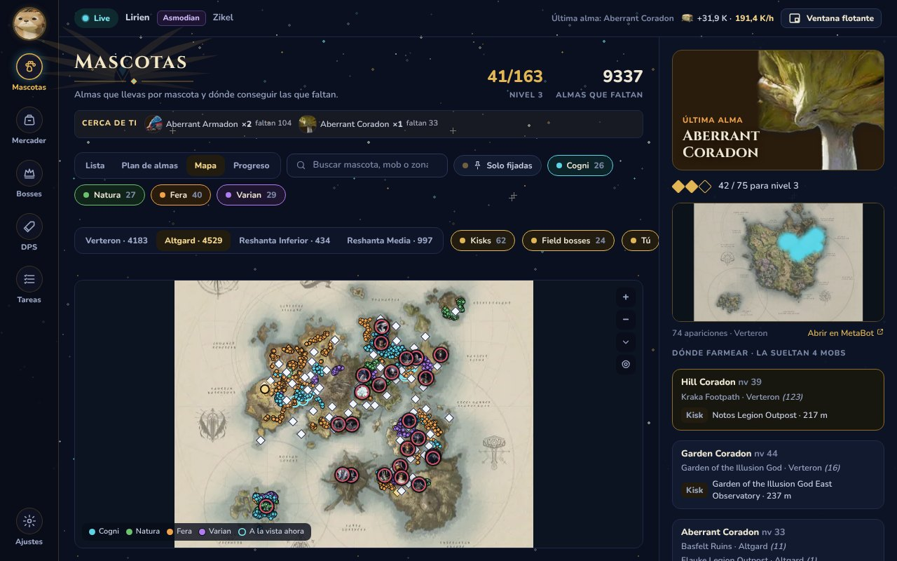 <b>Mapa</b>: las apariciones que te faltan, los kisks, los field bosses y tú.</td>
</tr>
<tr>
<td width="50%">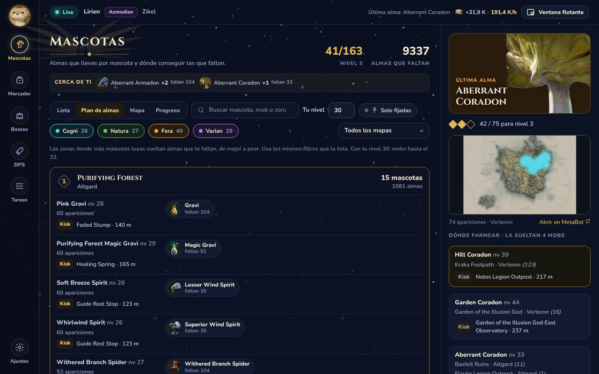 <b>Plan de almas</b>: adónde ir para avanzar más mascotas a la vez, a tu nivel.</td>
<td width="50%">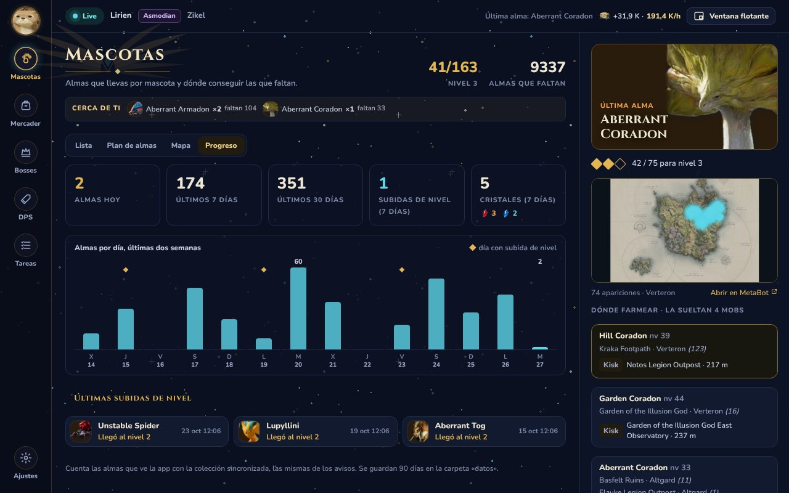 <b>Progreso</b>: tus almas día a día y las últimas subidas de nivel.</td>
</tr>
<tr>
<td>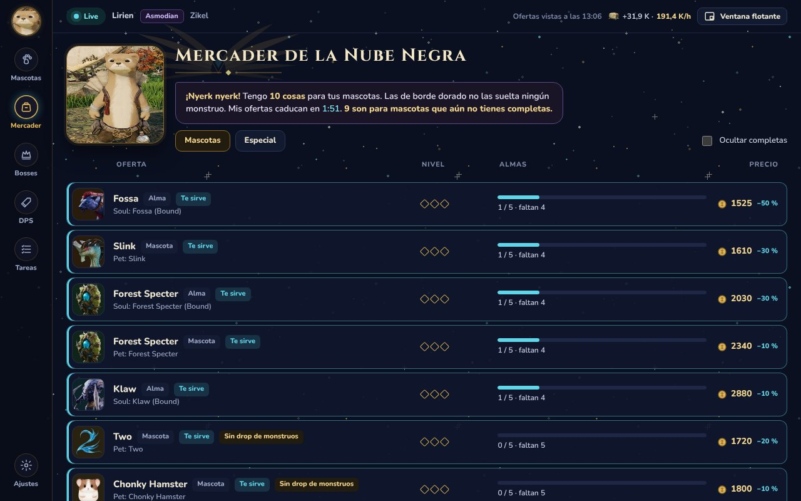 <b>Mercader</b>: lo que vende para las mascotas que no has terminado.</td>
<td>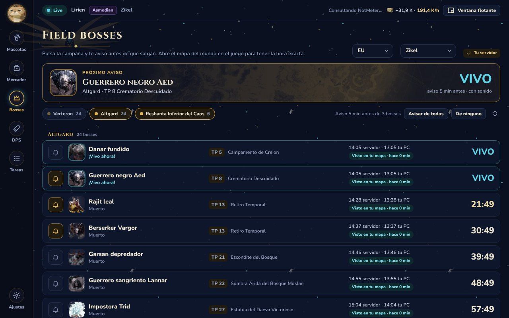 <b>Field bosses</b>: cuenta atrás, teletransporte (kisk) y campana para avisar.</td>
</tr>
<tr>
<td>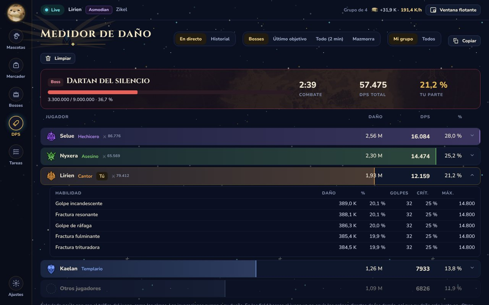 <b>Medidor de DPS</b>: tú y tu grupo, y las habilidades de cada uno.</td>
<td>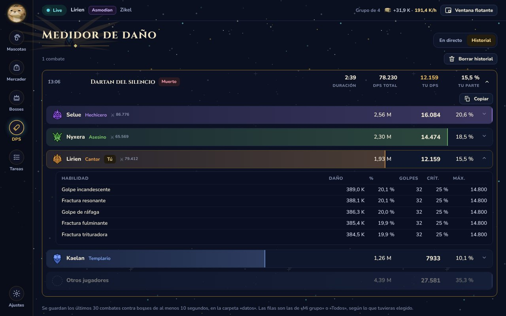 <b>Historial de DPS</b>: cada pelea contra un boss, guardada al terminar.</td>
</tr>
<tr>
<td>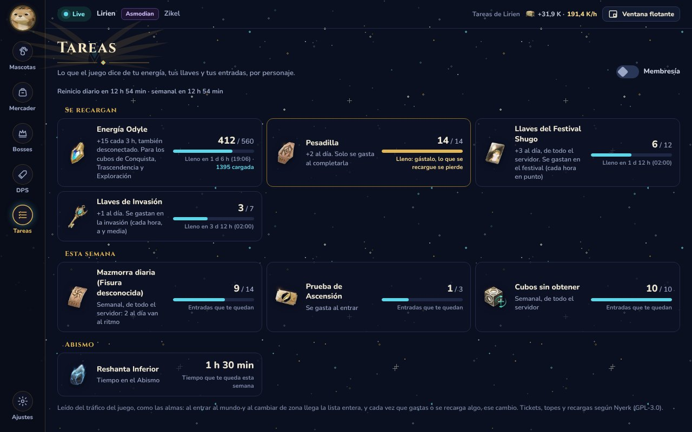 <b>Tareas</b>: energía, llaves y entradas, directamente del juego.</td>
<td>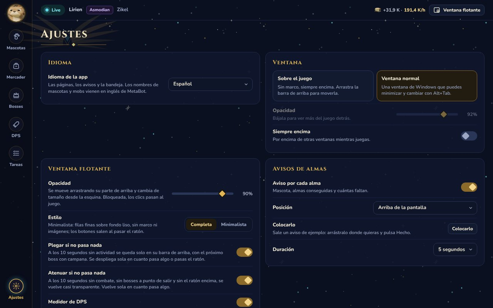 <b>Ajustes</b>: ventana, avisos, sonidos, idioma, abrir con Windows, actualizaciones.</td>
</tr>
</table>

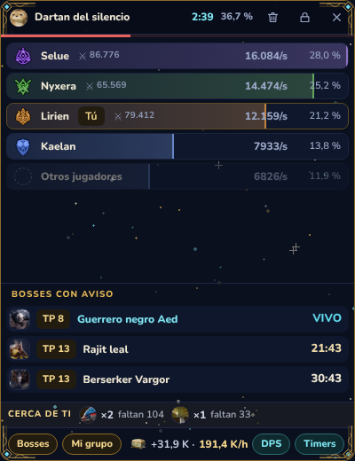
&nbsp;&nbsp;
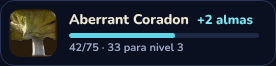 
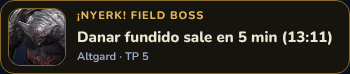 
La ventana flotante sobre el juego, y los avisos de alma y de field boss.

## Instalar

**Necesitas:** Windows 10 u 11 de 64 bits (x64) y [Npcap](https://npcap.com/#download). Si usas otro medidor
de DPS, seguramente ya lo tienes. WebView2 viene con Windows 11 (en Windows 10 la app te avisa si falta).

1. Instala [Npcap](https://npcap.com/#download) con las opciones por defecto.
2. En la [última versión](https://github.com/r3b0rNjHs/aion2-companion-releases/releases/latest), descarga **Aion2Companion-Setup-….exe** de **Assets** y ábrelo. Se instala solo para tu usuario, sin pedir administrador, y añade **Aion 2 Companion** al menú Inicio (y, si lo marcas, al escritorio).
3. Abre la app y **después** entra al mundo con tu personaje desde la selección de personaje. Es entonces cuando el juego envía tu colección de mascotas.

> **¿«Windows protegió su PC»?** El instalador no va firmado, así que Windows avisa la primera vez.
> Pulsa **Más información → Ejecutar de todas formas**. Cada versión lista el SHA-256 de sus archivos en `SHA256SUMS.txt`.

**Sin instalar:** extrae el ZIP portable (`Aion2Companion-…-portable.zip`, en la [última versión](https://github.com/r3b0rNjHs/aion2-companion-releases/releases/latest))
donde quieras y abre `Aion2Companion.exe`. La copia portable no se actualiza sola.

### Actualizaciones

La app instalada busca una versión nueva al abrirse y la instala sola (se vuelve a abrir en unos segundos,
con tu progreso). Mientras está abierta mira cada hora y, si sale una, aparece arriba un botón
**Actualizar**: nunca se reinicia en mitad de un combate. Puedes desactivarlo en Ajustes.

### Desinstalar

Configuración de Windows → Aplicaciones → **Aion 2 Companion** → Desinstalar. Te pregunta si borrar también tu
progreso y tus ajustes (la carpeta `datos` en `%LOCALAPPDATA%\Programs\Aion2Companion`): di que no para
conservarlos.

## Consejos

- **«Esperando colección»**: vuelve a la selección de personaje y entra al mundo con la app abierta. Si abriste
  la app con el personaje ya dentro, sigue desde tu última sesión en cuanto el juego diga tu nombre (al cambiar
  de zona o en unos minutos).
- **DPS «Mi grupo»** muestra a ti y a tu grupo; el daño del resto en un field boss va en una fila
  «Otros jugadores». **Todos** muestra a todo el que la app ve.
- La **papelera** limpia el medidor al momento. La pelea que mostraba se guarda en **DPS → Historial**, donde **Copiar** te da un resumen para pegar en el chat del grupo.
- **Ajustes → Bandeja → Abrir con Windows** abre la app escondida en la bandeja al encender el PC.
- **Las horas de los field bosses** son exactas cuando abres el mapa del mundo en el juego; las demás llegan de NotMeter.
- **Sobre el juego:** Ajustes → Ventana → «Sobre el juego» da una ventana sin marco siempre encima, y la ventana
  flotante (el botón de arriba) se puede bloquear para que los clics pasen al juego.

## ¿Es seguro?

Lee los datos que el juego ya envía a tu PC, igual que los medidores de DPS, a través de Npcap. No toca el
juego, ni sus archivos ni su memoria, y no le envía nada.

Se conecta a:

- **GitHub** (este repositorio): para buscar actualizaciones, al abrirse y cada hora. Las actualizaciones se comprueban con su SHA-256 antes de instalarse.
- **NotMeter** (`raw.githubusercontent.com`): las horas de los field bosses de tu servidor, cada 2 minutos con la app abierta.
- **MetaBot.GG**: las piezas del mapa de apariciones de una mascota, la primera vez que lo abres (luego se guardan en tu PC).

Nada más: sin cuentas, sin anuncios, sin analíticas. Las páginas de la app no pueden salir a internet (su
navegador está limitado a los archivos de la propia app), y todo lo que ves, imágenes incluidas, viene con ella.

Aun así, NCSOFT no la ha aprobado y sus normas prohíben programas de terceros no autorizados.
**Úsala bajo tu responsabilidad.**

## ¿Algo va mal?

| Ves | Prueba esto |
| --- | --- |
| `Esperando colección` | Vuelve a la selección de personaje y entra al mundo con la app abierta. |
| `Juego no detectado` | Comprueba que el juego está abierto. Abre la app antes de entrar al mundo. |
| `Npcap missing` / `Error de captura` | Instala [Npcap](https://npcap.com/#download) y vuelve a abrir la app. Si sigue, ábrela como administrador. |
| Un mensaje sobre WebView2 | Instala [WebView2 Runtime](https://developer.microsoft.com/microsoft-edge/webview2/) (Evergreen) y vuelve a abrir la app. |
| Los números no cuadran con el juego | Vuelve a entrar al mundo desde la selección de personaje. El juego siempre manda. |

**Ajustes → Diagnóstico → Comprobar** revisa Npcap, WebView2 y los archivos de la app. ¿Sigues atascado?
[Abre una incidencia](https://github.com/r3b0rNjHs/aion2-companion-releases/issues) con ese texto o con
`datos\pet_overlay.log`.

## Código fuente y licencia

Aion 2 Companion es software libre bajo la [GPL-3.0](https://www.gnu.org/licenses/gpl-3.0.html). Cada versión
incluye su código fuente completo (`Aion2Companion-<versión>-source.zip`), con sus avisos y las licencias de
todo lo que usa.

## Créditos

- El overlay de mascotas del que partió: [Aion 2 Pet Overlay](https://github.com/MartinLVila/aion2-pet-overlay), de **mytzuo** ([apóyale en PayPal](https://paypal.me/mytzuo)).
- Decodificación de paquetes basada en [elkaida/AION2-pet-tracker](https://github.com/elkaida/AION2-pet-tracker).
- La lectura de combate, los nombres de NPC y habilidades y los emblemas de clase: portados de [A2Tools DPS Meter](https://github.com/taengu/A2Tools-DPS-Meter) (GPL-3.0).
- Mascotas, mapas de apariciones y retratos: [MetaBot.GG](https://metabot.gg/en/aion-2/mounts). Horas de field bosses: [NotMeter](https://github.com/Not4You-Dev/NotMeter-Cache).
- IDs de objetos del mercader: [Questlog.gg](https://questlog.gg/aion-2).

---

Proyecto no oficial de fans, sin relación con NCSOFT ni respaldado por ella. AION es una marca de NCSOFT Corporation.
Las capturas usan personajes inventados.
