

# Aion 2 Companion

**Pet souls, the Black Cloud Merchant, field boss timers and a live DPS meter for Aion 2, in one app.**

### [⬇ Download the latest version](https://github.com/r3b0rNjHs/aion2-companion-releases/releases/latest)

The installer (`Aion2Companion-Setup-….exe`) and the portable ZIP are under **Assets** on the release page ·
[All releases](https://github.com/r3b0rNjHs/aion2-companion-releases/releases) ·
**English** · [Español](README.es.md)

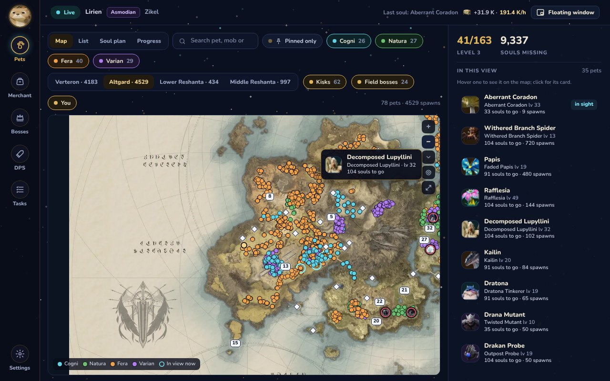

## What it does

| | |
| --- | --- |
| **Pet map** | The first thing you see: Verteron, Altgard and the Reshantas as whole maps you drag and zoom, centred on you. Every spawn of the mobs you still need, by genus, the kisks with their teleport number, the field bosses and you, where the game says you are; beside it, the pets of what's in view. |
| **Pet list** | Every pet you haven't maxed, with its portrait, your souls, the mob that drops it, the zone, the nearest kisk and a map of its spawns. A popup on every soul tells you how many are left, and "Near you" shows which of your soul mobs are in view. |
| **Soul plan** | The zones where the most of your unfinished pets drop souls, best first: one trip moves several of them along. Enter your level and mobs still too strong for you are left out. |
| **Progress** | Your souls today, this week and this month, souls per day for the last two weeks, and the latest pets to level up. |
| **Black Cloud Merchant** | Open Pets or Special at the merchant and the app shows what's for sale against your collection: what you still need comes first, with its discount. |
| **Field bosses and events** | Timers for your server, read from your own world map and from NotMeter, plus the game's events (Shugo Festival, Spacetime Rift, Dimensional Invasion, the siege, resets). Ring a bell and get a popup and a sound before it starts. |
| **Tasks** | Your Odyle Energy, keys and Nightmare with when they're full, the week's entries left and your Abyss time, as the game counts them, per character. |
| **DPS meter** | Live damage per player and per skill, with class emblems, for you and your party. Every boss fight is kept in a history, with your record against each boss. Copy a fight's summary for the party chat or Discord. The **rotation check** puts a fight next to [NotMeter](https://notmeter.com/)'s players of your class and combat power on that boss, skill by skill. Also in a small floating window over the game. |
| **Builds** | Paste a link to a guide from questlog.gg's Character Builder and the app brings in all its builds: gear, skills in their slots, macros, skill priority and how to play it. Pick one as your build for your class. |
| **And more** | Kina per hour, genus crystals counted, party invitation alerts, opening with Windows. English and Spanish (Settings → Language). |

Works on the **Global servers (EU/NA)**.

<table>
<tr>
<td colspan="2">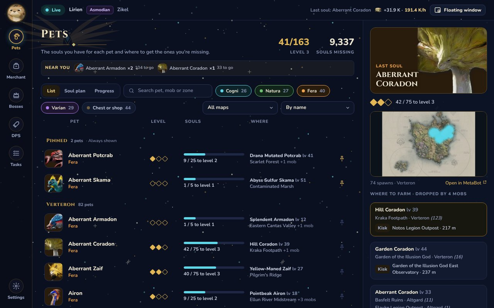 <b>Pet list</b>: every pet you haven't maxed, grouped by map, with where to farm it and the nearest kisk.</td>
</tr>
<tr>
<td width="50%">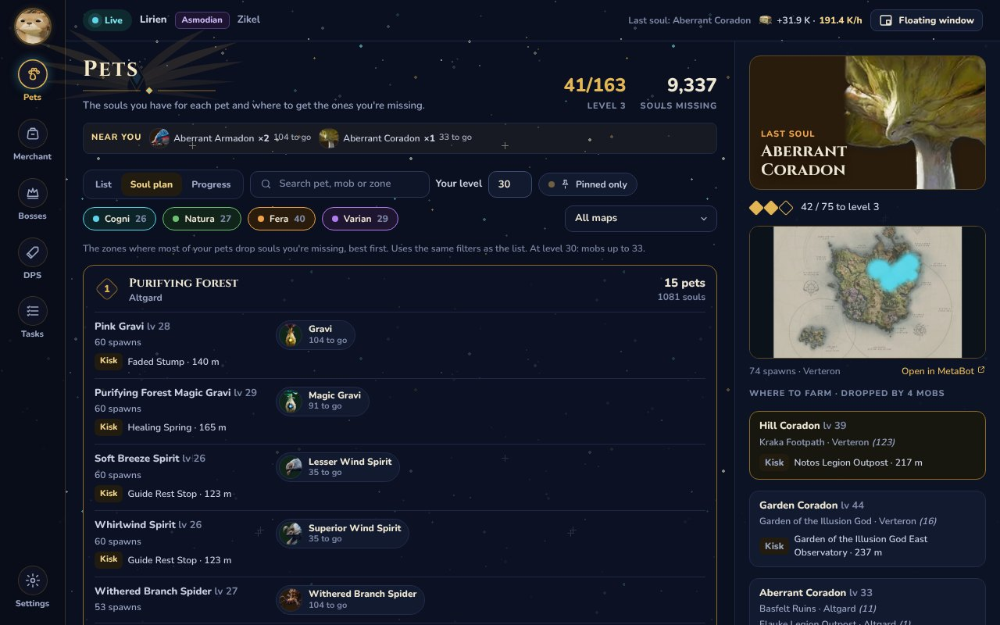 <b>Soul plan</b>: where to go to move the most pets along, at your level.</td>
<td width="50%">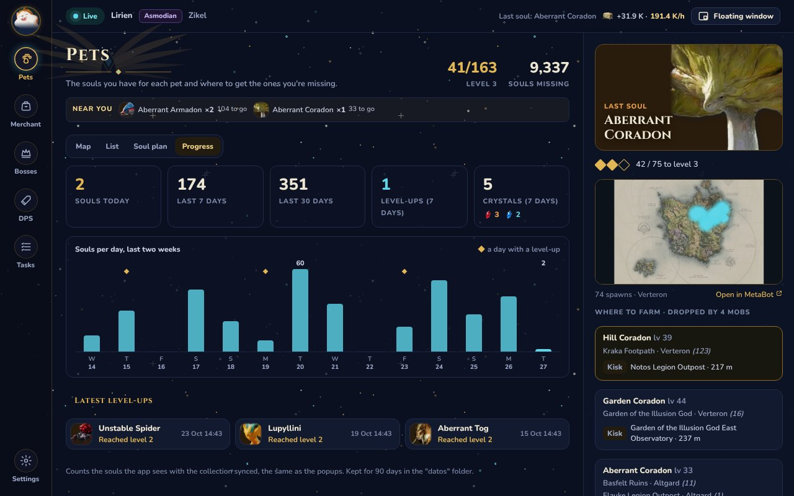 <b>Progress</b>: your souls day by day and the latest level-ups.</td>
</tr>
<tr>
<td>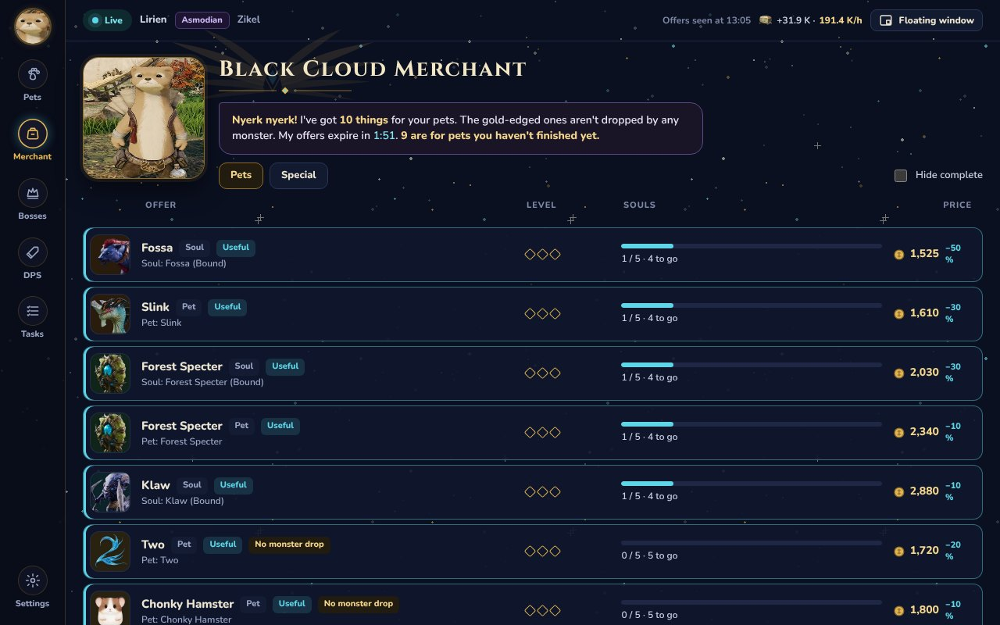 <b>Merchant</b>: what's on sale for the pets you haven't finished.</td>
<td>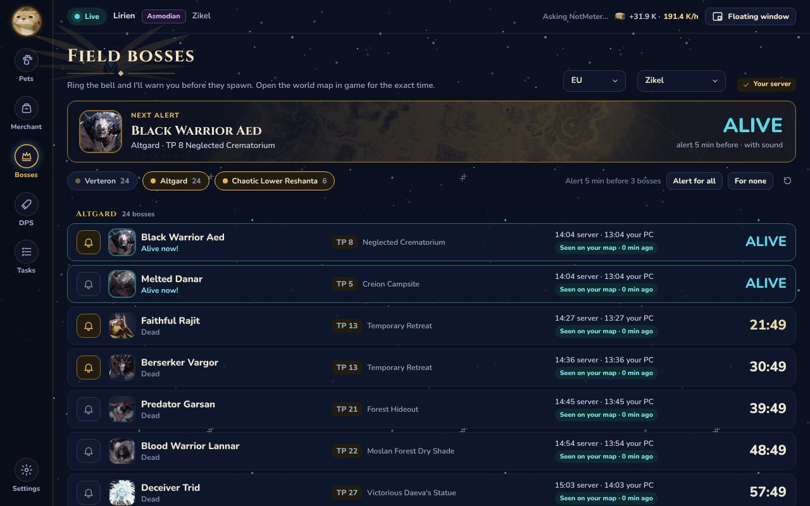 <b>Field bosses</b>: countdowns, teleport (kisk) and a bell for alerts.</td>
</tr>
<tr>
<td>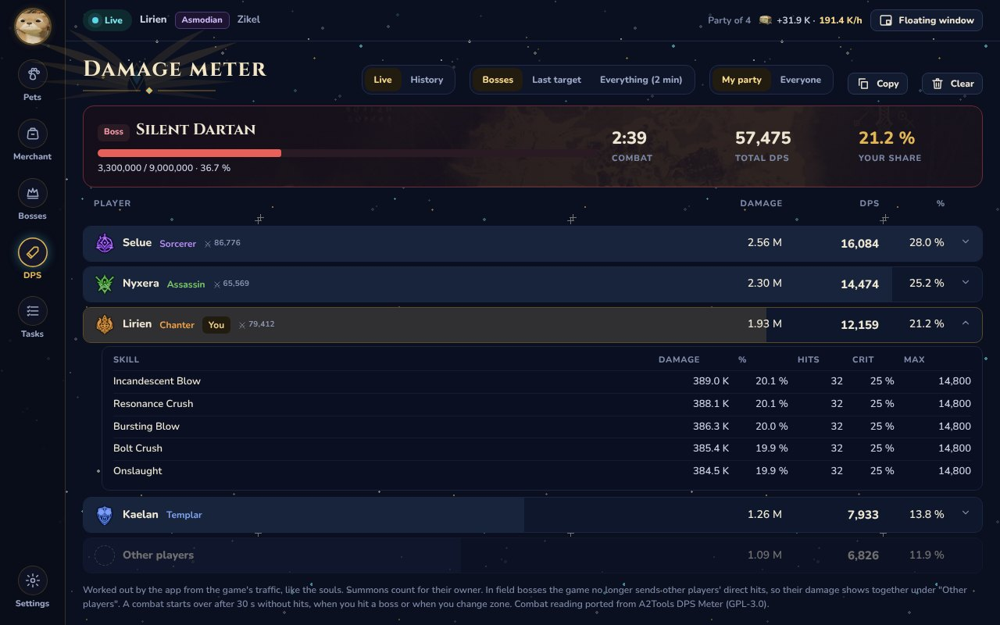 <b>DPS meter</b>: you and your party, and each one's skills.</td>
<td>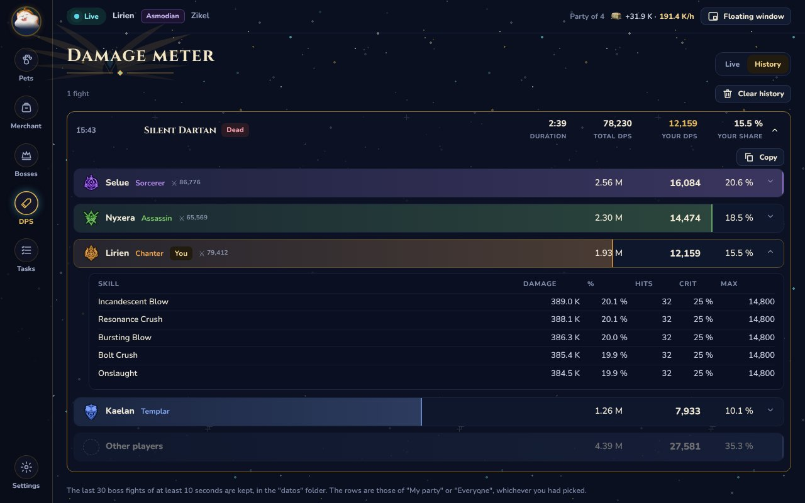 <b>DPS history</b>: every boss fight, kept when it ends.</td>
</tr>
<tr>
<td>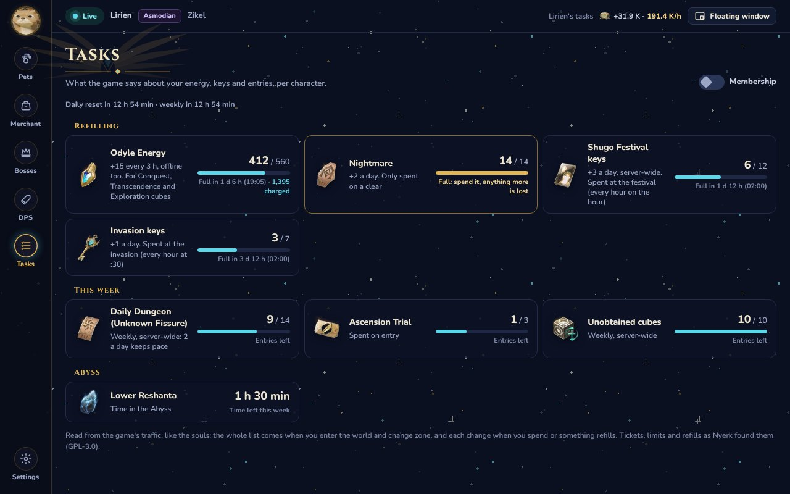 <b>Tasks</b>: energy, keys and entries, straight from the game.</td>
<td>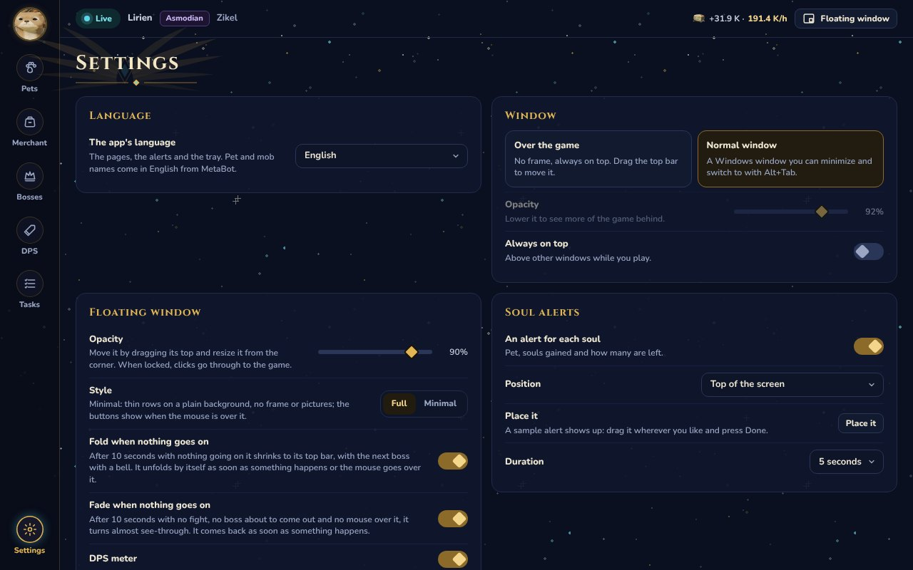 <b>Settings</b>: window, popups, sounds, language, opening with Windows, updates.</td>
</tr>
</table>

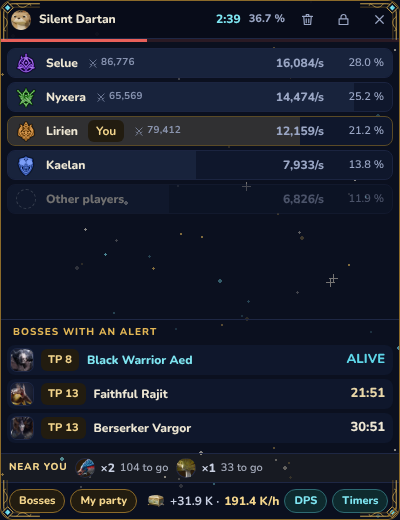
&nbsp;&nbsp;
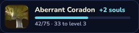 
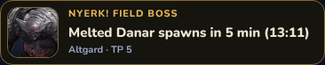 
The floating window over the game, and the soul and field boss popups.

## Install

**You need:** Windows 10 or 11, 64-bit (x64), and [Npcap](https://npcap.com/#download). If you use another
DPS meter you probably have Npcap already. WebView2 comes with Windows 11 (on Windows 10 the app tells you if
it's missing).

1. Install [Npcap](https://npcap.com/#download) with its default options.
2. On the [latest release](https://github.com/r3b0rNjHs/aion2-companion-releases/releases/latest), download **Aion2Companion-Setup-….exe** from **Assets** and run it. It installs for your user only, without asking for administrator rights, and adds **Aion 2 Companion** to the Start menu (and, if you tick it, the desktop).
3. Open the app, **then** log in and enter the world with your character from character select. That's when the game sends your pet collection.

> **"Windows protected your PC"?** The installer isn't signed, so Windows warns you the first time.
> Click **More info → Run anyway**. Every release lists the SHA-256 of its files in `SHA256SUMS.txt`.

**Without installing:** extract the portable ZIP (`Aion2Companion-…-portable.zip`, on the [latest release](https://github.com/r3b0rNjHs/aion2-companion-releases/releases/latest))
anywhere and open `Aion2Companion.exe`. The portable copy doesn't update itself.

### Updates

The installed app looks for a new version when it opens and installs it by itself (it reopens in a few
seconds, your progress kept). While it's open it checks every hour, and if one comes out an **Update** button
appears at the top: it never restarts in the middle of a fight. You can turn this off in Settings.

### Uninstall

Windows Settings → Apps → **Aion 2 Companion** → Uninstall. It asks whether to delete your progress and
settings too (the `datos` folder in `%LOCALAPPDATA%\Programs\Aion2Companion`): say No to keep them for later.

## Tips

- **"Waiting for collection"**: go back to character select and enter the world with the app open. If you
  opened the app with your character already in the world, it carries on from your last session as soon as the
  game names you (on a zone change or within a few minutes).
- **DPS "My party"** shows you and your party; everyone else's damage on a field boss goes into one
  "Other players" row. **Everyone** shows everybody the app sees.
- The **bin** clears the meter at once. The fight it showed is kept in **DPS → History**, where **Copy** gives you a summary to paste in the party chat.
- **Settings → Tray → Open with Windows** starts the app hidden in the tray when you turn on your PC.
- **Field boss times** are exact when you open the world map in game; the rest come from NotMeter.
- **Over the game:** Settings → Window → "Over the game" gives a frameless window that stays on top, and the
  floating window (the button at the top) can be locked so clicks go through it.

## Is it safe?

It reads the data the game already sends to your PC, the same way DPS meters do, through Npcap. It doesn't
touch the game, its files or its memory, and it doesn't send anything to the game.

It connects to:

- **GitHub** (this repository): to look for updates, when it opens and every hour. Updates are checked against their SHA-256 before they're installed.
- **NotMeter** (`raw.githubusercontent.com`): field boss times for your server, every 2 minutes while the app is open; and its rankings when you press Rotation check on a fight.
- **questlog.gg**: a guide's builds, names and icons, only when you import its link in Builds.
- **MetaBot.GG**: the map tiles of a pet's spawn map, the first time you open it (then they're kept on your PC).

Nothing else: no accounts, no ads, no analytics. The app's pages can't reach the internet at all (their
browser is locked to the app's own files), and everything you see, pictures included, ships with the app.

Still, it isn't approved by NCSOFT, and their rules ban unauthorized third-party programs.
**Use it at your own risk.**

## Something's wrong?

| You see | Try this |
| --- | --- |
| `Waiting for collection` | Go back to character select and enter the world with the app open. |
| `Game not detected` | Make sure the game is running. Open the app before entering the world. |
| `Npcap missing` / `Capture error` | Install [Npcap](https://npcap.com/#download) and reopen the app. If it persists, run the app as administrator. |
| A message about WebView2 | Install the [WebView2 Runtime](https://developer.microsoft.com/microsoft-edge/webview2/) (Evergreen) and reopen the app. |
| Numbers don't match the game | Re-enter the world from character select. The game is always right. |

**Settings → Diagnostics → Check** reviews Npcap, WebView2 and the app's files. Still stuck?
[Open an issue](https://github.com/r3b0rNjHs/aion2-companion-releases/issues) with that text, or with
`datos\pet_overlay.log`.

## Source code and license

Aion 2 Companion is free software under the [GPL-3.0](https://www.gnu.org/licenses/gpl-3.0.html). Every
release includes its full source code (`Aion2Companion-<version>-source.zip`), with its notices and the
licenses of everything it uses.

## Credits

- The pet overlay it started from: [Aion 2 Pet Overlay](https://github.com/MartinLVila/aion2-pet-overlay), by **mytzuo** ([support them on PayPal](https://paypal.me/mytzuo)).
- Packet decoding based on [elkaida/AION2-pet-tracker](https://github.com/elkaida/AION2-pet-tracker).
- The combat reader, NPC and skill names and class emblems: ported from [A2Tools DPS Meter](https://github.com/taengu/A2Tools-DPS-Meter) (GPL-3.0).
- Pets, spawn maps and portraits: [MetaBot.GG](https://metabot.gg/en/aion-2/mounts). Field boss times and the rotation check's rankings: [NotMeter](https://notmeter.com/) ([cache](https://github.com/Not4You-Dev/NotMeter-Cache), [rankings](https://github.com/Not4You-Dev/NotMeter-Global-Ranking-Cache)). All rights to NotMeter's data belong to NotMeter; we recommend using [their official site](https://notmeter.com/). Aion 2 Companion is free and non-profit.
- Merchant item IDs, and the builds you import: [Questlog.gg](https://questlog.gg/aion-2).

---

Unofficial fan project, not affiliated with or endorsed by NCSOFT. AION is a trademark of NCSOFT Corporation.
The screenshots use made-up characters.
